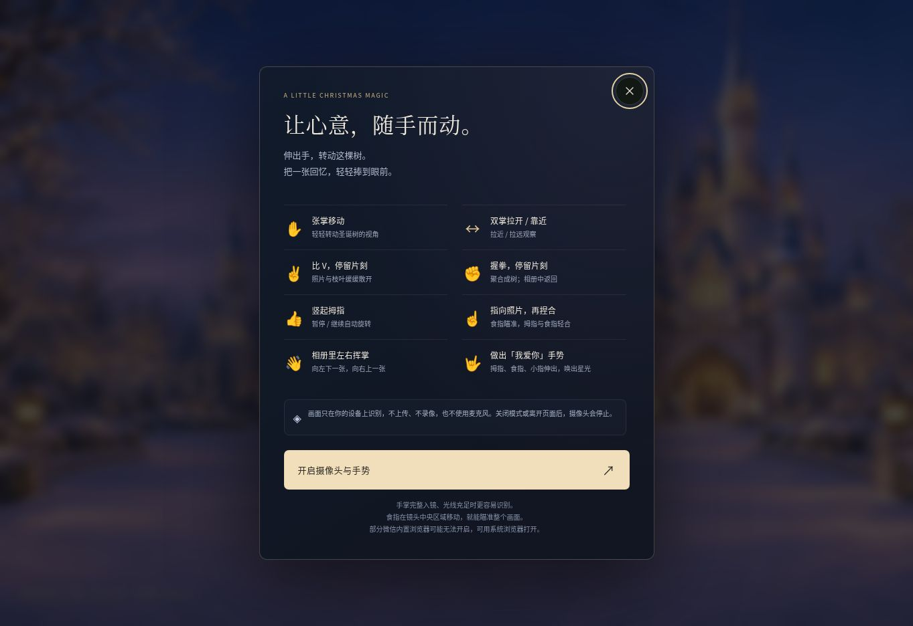

# 圣诞树维护历史（原 README 归档）

归档日期：**2026-11-12**。以下是 Sites v26 源码中原 README 的完整技术内容；移动后的相对链接已修正。它包含较早状态，**不是当前全站进度说明**。先读 [当前 README](../README.md) 与 [完整交接](CLAUDE_HANDOFF.md)。

- 原文 `cat.video: null`、已撤下影片入口的说法过时。当前 `public/scene.json` 实际仍配置 `videos/starlight-return.mp4`，圣诞播放器代码会使用生成后的 MP4。
- 原文两分钟《星光归来》计划属于旧阶段；当前继续任务是目标 322 秒的《今晚，改道》，实际新生成片段仍为 0。见 [新电影制作交接](../production/tonight-we-change-course/README.md)。
- 主域名现有告白体验为 203 秒旧片 + 90 秒尾声，圣诞树固定入口为 `/christmas/`，日期路由与实际发布状态以当前源码和交接记录为准。
- 原文 `docs/HD_UPDATE.md` 在当前源码中不存在；对应链接改向现存 [PERFORMANCE.md](PERFORMANCE.md)。没有编造或补写缺失原文。
- 历史指标、截图和测试只证明当时记录的检查，不代表当前 iPhone 微信实机、WebGL 或小猫观感已经验收。

---

# 照片圣诞树

当前版本以迪士尼童话圣诞和《白雪公主》式的森林气氛为美术方向：手绘城堡、雪林、暖金灯窗、照片圣诞树和灰白小猫组成一个可环绕观看的场景。镜头沿同一个方向持续转动，约 120 秒完成 360°，经过一圈后继续前进。城堡上空有实时升起、绽放和落下的金色烟花；保留照片聚散、手势魔法、柔金彩灯与飘雪。树使用实体 3D 几何，小猫使用带骨骼与动作片段的 GLB 模型；远处城堡与森林由八张方向画和一张兜底全景共同呈现，固定在有雪地的有限空间中。

本轮源码已撤下旧 30 秒短片入口，`cat.video` 设为 `null`；两分钟公主剧情片目前生成受阻，尚无新成片。照片改用共享图集，小猫改用骨骼动画模型。本文记录当前源码状态，不表示本轮部署或浏览器 3D 验收已经完成。

礼物地址：[集美小喵的圣诞魔法](https://jimeixiaomiao.wildmole.chatgpt.site/)（平台子域名，无需另购域名）。

首页只显示场景和左下角祝福：

> 祝集美小喵【zkl】圣诞节快乐

祝福以原创猫爪 SVG 字标显示，采用象牙白、暖红和金色手绘笔画，含猫耳、肉垫与猫尾下划线；文字轮廓不依赖系统字体。细金线、冬青叶与红莓构成静态页角，页面和弹窗统一使用午夜蓝、暖金与红色。没有常驻工具栏或可见操作说明。相册、分享和可选的手势魔法保留为隐藏入口。

当前八方向背景的原生尺寸、精确投影、资源预算与验证结果见 [八方向背景说明](multiview-background.md)。前一轮屏幕分辨率、照片图集与验证记录见 [高清更新记录](PERFORMANCE.md)；全景原图、早期投影修正与旧版尝试保留在 [历史背景说明](../public/backgrounds/README.md)。

## 隐藏交互

| 操作 | 效果 |
| --- | --- |
| 单击／单点空白 | 暂停或继续镜头漫游 |
| 单击／单点照片 | 打开所选照片的高清大图 |
| 双击／双点 | 散开或聚合 |
| 点击树旁小猫 | 小猫短暂停留并以星光回应；当前没有短片播放入口 |
| 拖动／单指滑动 | 改变观察视角 |
| 滚轮／双指缩放 | 1–4 倍整体光学缩放，树、城堡与地面一同放大 |
| 长按照片约 0.65 秒 | 打开这张照片的大图 |
| 长按空白约 0.65 秒 | 打开链接与二维码分享 |
| 舞台获得键盘焦点后按空格／回车 | 分别控制镜头漫游／聚散 |
| 长按左下角祝福约 1 秒，或按 H | 打开手势魔法图鉴；点击开启后才请求摄像头 |

单击延迟约 330 ms 判定，避免双击先误触暂停。拖动、两指缩放和指针取消不会触发这些彩蛋。系统开启减少动态效果时，镜头停止自动漫游，场景直接切换聚散状态。上述说明仅供维护者查看，不会出现在首页。

高清查看器支持鼠标滚轮、双击、手机双指缩放，放大后拖动查看细节；提供放大／缩小、原始尺寸、还原和关闭按钮。百分比相对照片的原始尺寸，最高到 100%，不额外放大源像素或重绘人脸。适合窗口时保留左右滑动翻页，放大拖动和捏合不会翻页；切换照片自动还原。查看时暂停场景，关闭后保留之前的场景缩放与旋转状态。

## 可选的手势魔法

开启后可用张掌移动转动视角、双掌拉开 / 靠近缩放、V 手势散开、握拳聚合、竖拇指暂停 / 继续、食指瞄准后捏合打开照片、相册里挥手翻页，以及 🤟 唤出柔和星光。图鉴、预览、识别状态和退出按钮只在用户进入模式后出现。

模型在本机 Worker 中运行，摄像头画面不上传、不录像，不请求麦克风。普通首屏不加载模型；退出模式或切到后台就停止摄像头。部分微信浏览器不能使用摄像头时可继续用触摸操作。

使用方法、扩展接口和验证范围见 [手势魔法说明](HAND_MAGIC.md)，参与开发见 [贡献说明](../CONTRIBUTING.md)。



图为先前已发布版本的实际线上手势图鉴，保留交互记录；第 9 版已更新配色。截图环境未启用摄像头、禁用了 WebGL，不能作为当前 3D 合成效果或真人手势准确率的验证。

## 本地运行

需要 Node.js 20.19 或更新版本。

```bash
npm ci
npm run dev
```

开发和构建前自动处理照片、背景、场景配置和固定版本手势资源。首次准备模型需要网络连接：

```bash
npm run photos
npm run scene
npm run lint
npm test
npm run build
npm run preview
```

## 替换照片

把照片放进 `public/photos/`，支持 JPG、JPEG、PNG、WebP、AVIF。文件名不用连续编号，张数也不用预先确定。默认 `top.*` 在前，其余按自然文件名排序。

```text
public/photos/
  top.jpg
  1.jpg
  2.jpg
  海边.png
```

生成脚本不覆盖原始文件。生成结果在 `public/generated/`，不提交到源码仓库。

可选地创建 `public/photos/manifest.json`，指定顺序和说明：

```json
{
  "photos": [
    {"file": "top.jpg", "alt": "第一张照片"},
    {"file": "海边.png", "caption": "想写的说明", "alt": "海边合照"},
    "2.jpg"
  ]
}
```

有清单时只选择列出的照片；无清单时自动发现目录内照片。替换有清单引用的文件时，也要更新清单。显式的 `{"photos":[]}` 表示空相册；即使没有照片，实体树、灯和星星仍然存在。

每张照片生成最长边 320 px 的相册缩略图、384 px 的树上照片裁片，以及保留原始定向尺寸的相册显示图（WebP quality 94）。自动修正 EXIF 方向、去除输出元数据，不放大小图。构建时再将树上裁片合成一张 3840×3840 WebP 图集，每张照片保留 368×368 的画面区域与外扩边缘；树的正常首屏照片请求由 95 次降为 1 次，资源体积从独立裁片合计 **4,337,788 bytes** 降至图集 **2,036,052 bytes**。完整图集解码后一次更新纹理，全部照片一起淡入；图集失败时仅回退一次，最多三路并发加载独立裁片，整批完成再显示。相册原尺寸图仍按需加载，95 张源文件逐字节不变。

当前使用用户 ZIP 中的 95 张原图，原文件逐字节保留，蓝裙照片 Image_2026-11-07_040144_237.jpg 为封面；两种树上实例数量都能覆盖本次全部照片。来源记录见 [PHOTO_SOURCES.md](PHOTO_SOURCES.md)。

照片是“挂在树上的卡片”：桌面 128 个实例、窄屏 96 个，主要为较小照片，少量大照片点缀。按树表面积分布，给顶端、主干和枝叶留出空间。照片数量不足时重复使用；这不是要求提供的原照片数量。大相册会均匀采样到树上，完整相册仍可浏览。

## 更换背景、祝福和小猫

编辑 `public/scene.json`。下例展示当前原全景与八方向图的配置；每张方向图必须保持自己的实际相机朝向、视场和宽高比：

```json
{
  "greeting": "祝集美小喵【zkl】圣诞节快乐",
  "background": {
    "image": "backgrounds/storybook-castle-360.webp",
    "brightness": 0.94,
    "projection": "equirectangular",
    "rotation": 0,
    "panels": [
      { "image": "backgrounds/storybook-view-00.webp", "yaw": 5.4, "pitch": -10, "horizontalFov": 60, "verticalFov": 60 },
      { "image": "backgrounds/storybook-view-01.webp", "yaw": 50.4, "pitch": -10, "horizontalFov": 60, "verticalFov": 60 },
      { "image": "backgrounds/storybook-view-02.webp", "yaw": 95.4, "pitch": -10, "horizontalFov": 60, "verticalFov": 60 },
      { "image": "backgrounds/storybook-view-03.webp", "yaw": 140.4, "pitch": -10, "horizontalFov": 60, "verticalFov": 60 },
      { "image": "backgrounds/storybook-view-04.webp", "yaw": 185.4, "pitch": -10, "horizontalFov": 60, "verticalFov": 60 },
      { "image": "backgrounds/storybook-view-05.webp", "yaw": 230.4, "pitch": -10, "horizontalFov": 60, "verticalFov": 60 },
      { "image": "backgrounds/storybook-view-06.webp", "yaw": 275.4, "pitch": -10, "horizontalFov": 60, "verticalFov": 60 },
      { "image": "backgrounds/storybook-view-07.webp", "yaw": 320.4, "pitch": -10, "horizontalFov": 60, "verticalFov": 60 }
    ]
  },
  "snow": true,
  "cat": {
    "image": "characters/christmas-cat.png",
    "video": null
  }
}
```

- 当前 `projection: "equirectangular"` 以原全景覆盖完整 360×180°，再按实际透视投影拼接八张独立生成的原生 1254×1254 方向图。每张覆盖 60°×60°，中心相隔 45°，相邻重叠 15°。高空、较低雪地与加载中的方向由原全景补齐。整体方向固定在世界空间，`rotation` 设置共同朝向；镜头持续环绕时可以看到不同方向。城堡画作由 AI 生成，没有实景摄影或完整 3D 建筑模型的含义。
- `panels` 最多配置八张图，`yaw` 为水平方向、`pitch` 为仰俯角，负值向下；`horizontalFov` 与 `verticalFov` 是生成参考使用的真实相机视场。普通透视图不能当作全景矩形直接贴入。构建会拒绝图像比例与透视镜头不一致的配置；实际投影与全部交界的核验结果见 [八方向背景说明](multiview-background.md)。
- `projection: "perspective"` 保留给普通透视图：按原始宽高比放在固定平面上，使用有限观察弧度与 `focus` 构图。第 6–8 版使用过这条路径，当前整圈背景使用上述八方向模式。
- `projection: "image"` 保留屏幕对齐的普通图片兼容模式，此时 `focus` 控制横竖屏裁切。
- 背景必须放在 `public/backgrounds/`；原全景支持 JPG、JPEG、PNG、WebP、AVIF、SVG，方向图支持 JPG、JPEG、PNG、WebP、AVIF。`brightness` 为 0.12–1；`image: null` 使用深色夜空。兜底全景原生尺寸为 1774×887，八张方向图各为原生 1254×1254。构建上限分别为全景 8192 px、方向图 2048 px、旧透视图与普通图 4096 px，均不放大小图。方向图另生成最长边 1024 px 的备份，仅在设备最大纹理尺寸不足时使用；当前保留视线附近四张原尺寸图，以两路并发加载。
- 网页内的小猫使用 `src/assets/christmas-cat.glb` 中的骨骼蒙皮模型，大小为 **345,976 bytes，约 346 KB**。`Idle` 与 `Walking` 动作按走停状态混合，步频随路线速度变化；眨眼由模型形变控制，身体高度和接触阴影随实际猫爪与雪面位置更新。模型以独立低优先级请求加载，不阻塞圣诞树首屏；暂停、页面隐藏与减少动态效果均受控制。点击小猫会短暂停留并回应星光。`cat.image` 仍保留 `public/characters/` 中的透明角色图，用于分享贺卡及兼容素材；它不承担场景里的行走动画。
- 当前 `cat.video: null` 已撤下旧短片的页面入口，点击小猫只触发星光回应。旧片的历史规格与制作记录保留在 [Google Vids 历史记录](GOOGLE_VIDS.md)。新的公主剧情片尚无可用片段，不能把剧本、角色参考图或旧片当作新成片接入。可选播放器代码仍保留加载提示、手动播放、失败重试、单独打开及保存功能；只有配置了实际视频后才启用。
- `snow` 控制飘雪，`greeting` 控制左下角祝福。

可选播放器启用并打开时，会请求一次完整 MP4，以本地 Blob URL 播放；关闭或重试会取消未完成请求、停止媒体并释放 Blob URL。当前 `cat.video` 为 `null`，首屏不请求旧 MP4。

当前全景模式下，相机以约 3°/秒沿同一方向环绕，每 120 秒转完一圈，跨越 0°/360° 时持续前进。鼠标、触摸或手势操作优先于自动运动，交互后短暂等待，再从用户选定的方位继续。暂停、后台和系统减少动态效果会停止自动漫游；烟花同时冻结当前姿态。照片、枝叶、挂件和顶星共用固定的世界位置与朝向，只在聚散过渡中改变局部位置。第 6–8 版的正面 ±8° 往返保留为历史兼容功能。

背景穹顶固定在世界位置，下半球落在雪地平面；相机移动时背景不再跟随平移。雪面接触层使用不透明、写深度的材质，以固定拍摄原点和世界位置读取与背景相同的原全景、八方向图、旋转、亮度和重叠过渡，避免纹理跟着镜头滑动。它在树根和猫爪附近局部压暗，不叠加浅色受光圆盘、白雾或透明光圈。远景城堡仍是背景画作。实际相机的光学缩放同时放大树与背景。

## 微信链接和二维码贺卡

长按空白约 0.65 秒打开分享，复制当前页面地址或保存 1200×1800 PNG 贺卡。贺卡包含小猫、祝福和具有完整白边的二维码，也保留纯二维码下载。图片在浏览器本地生成；猫素材加载失败时使用树形装饰降级。平台子域名无需注册购买；独立 `.com` 等域名需要另行注册并绑定，不承诺永久免费的平台用量或中国内地微信可达性。

## Google Vids 圣诞视频

旧的约 30 秒短片采用人物静态照片与一条猫片拼接，已被弃用，并从当前页面配置撤下。历史操作、素材规格和提示词保留在 [Google Vids 历史制作记录](GOOGLE_VIDS.md)，不再作为当前网站的视频交付。

新的《星光归来》已完成统一的公主、小猫与城堡参考图，以及九幕无对白剧情方案：收到求助、入林寻星、遭遇寒溪、照顾小猫、取回星光、重开城门、点亮圣诞树、舞会与烟花。计划九段各 15 秒，直接剪切为 2 分 15 秒；八处各 0.5 秒重叠后为 2 分 11 秒。正片必须包含人物和小猫的连续行动，不能用静态照片撑时长。

当前 Google Vids 界面显示 **Omni**，实际选择 **16:9、1080p、15 秒**。两次 Create 均被页面拒绝，第二次改为无品牌名的原创虚构角色仍未通过；本轮已停止继续试探。**目前可用新片段为 0 条，尚未制成或接入新视频。** 不能将 Omni 标作已确认的 Veo，也不能将制作计划记作生成成功。新项目、完整剧情、逐幕提示词和准确进度见 [《星光归来》制作方案](PRINCESS_FILM_STORYBOARD.md)。

## 发布

Vite 使用相对资源路径，支持根目录或子目录托管。生产构建保留生成的 WebP、运行时清单、应用代码及小猫 GLB 等必要资源；原始照片、背景、角色原图、未启用的源视频及源配置不会重复放入最终产物。

当前公开礼物地址使用 Sites 托管。发布时构建当前源码，推送对应源码版本，保存与该提交一致的静态产物，再部署已保存版本；以部署成功状态和返回地址确认更新。

GitHub Pages 的 `gh-pages/preview-2026/` 工作流和 `npm run deploy` 保留为历史发布途径，不能用其推送结果代表当前 Sites 地址已更新。历史预览工作流保留根目录和根目录 `CNAME`。

静态托管中的照片能通过公开网址访问；`noindex` 是搜索索引设置，不是访问控制。

## 实现与验证

- `src/scene/TreeBody.tsx`：粗糙树皮、层叠松枝和约 2.47 万根有厚度的针叶，共三批受光照的实体几何。
- `src/scene/photo-layout.ts`：卡片和树体的空间关系、照片朝向和挂绳连接。
- `src/scene/PhotoOrnaments.tsx` / `photo-atlas-loader.ts`：预构建图集一次请求、解码后整批显示；失败时单次回退到三路独立裁片加载。带厚度和轻微卷曲的纸张、木夹与挂绳共用一批实例化绘制，`photo-material.ts` 提供物理材质与共享几何。
- `src/scene/TreeDetails.tsx`：彩灯、挂件、顶星，以及有远近层次的飘雪。
- `src/scene/NightBackground.tsx` / `panorama-panels.ts`：按真实透视方向拼接八张原生细节图，与原全景共同覆盖整圈；保留附近四张、两路并发加载，并和接触地面共享采样。结构与验证见 [八方向背景说明](multiview-background.md)；旧透视平面和屏幕平面图仍作为兼容模式。
- `src/scene/SnowGround.tsx` / `tree-base.ts` / `ground-composite.ts`：六条不规则根颈、雪面深度和局部接触阴影；全景与接触层共用采样，树根和猫爪周围不叠加白色雾圈。
- `src/scene/Snowfall.ts`：有远近层次、覆盖当前视野并在地面上方回收的雪花。
- `src/scene/camera-orbit.ts`：当前全景模式每 120 秒沿同一方向完整环绕，世界背景变换保持不动；有限弧度控制器仅用于透视兼容模式。
- `src/scene/ChristmasCat.tsx` / `cat-rig.ts` / `cat-behavior.ts` / `cat-placement.ts`：异步加载骨骼 GLB，混合 `Idle` / `Walking`，同步路线速度、猫爪雪面接触、眨眼与点击回应；不再用程序化拼接部件承担小猫主体与步行动画。
- `src/scene/FairytaleFireworks.tsx`：位于城堡方向的实时 3D 烟花，升空、绽放、弧形落下后消散，使用同一相机和正常深度遮挡。
- `src/scene/camera-framing.ts`：按横竖屏计算相机缩放与俯仰边界。
- `src/hooks/useSecretInteractions.ts`：无可见按钮的鼠标、触摸与键盘交互。
- `src/lib/hand-gestures.ts`：独立于模型的手势意图与防误触状态机。
- `src/hand-tracking/`：按需启动的摄像头、Worker、本机推理与资源释放。
- `src/components/HandMagicMode.tsx`：手势图鉴、模式状态、预览和退出。
- `src/components/StorybookFrame.tsx`：不截获点击的静态冬青金线页角；相册、分享、祝福字标与导出贺卡使用统一童话配色。
- `scripts/prepare-scene.mjs`：背景压缩与场景配置生成。
- `docs/PERFORMANCE.md`：性能与验证范围。

自动检查覆盖原图保留、图集与相册、相机连续整圈与暂停恢复、固定背景/雪地坐标、根部与猫爪深度、小猫动作、烟花生命周期，以及既有照片和手势交互；本轮发布与最终浏览器 3D 画面仍需分别确认。固定世界空间的 12 视图离屏核验结果记录在 `docs/world-motion-validation.json`；八方向图阶段与单张全景阶段的历史接触记录保留在 `docs/multiview-background-validation.json` 和 `docs/panorama-contact-validation.json`，它们不代表新版浏览器验收。

第 6–8 版透视背景的视口样本、同像素合成、约 952 万像素对比与根部构图数据，以及更早的 GLSL／离线结构检查，均在性能文档中作为历史记录保留，不代表当前全景画作或接缝已完成验收。

核验环境的浏览器禁用了 WebGL，真实摄像头测试也尚未完成。因此上述检查不代表最终浏览器合成画面、真人手势识别准确率、手机帧率或微信浏览器已经实机验收，详细范围见 [性能与验证说明](PERFORMANCE.md)。
