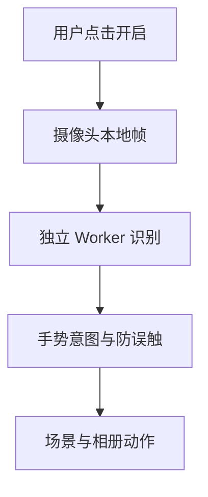

# 手势魔法

手势模式是可选的本机交互层。普通访问不申请摄像头权限，也不加载识别模型；原来的鼠标、触摸、键盘操作继续可用。

## 开启与退出

长按左下角祝福语约 1 秒，或按 **H**，打开手势图鉴。点击 **开启摄像头与手势** 后，浏览器才请求摄像头授权。只打开图鉴不会启动摄像头。

开启后右上角显示摄像头预览、手部骨架、识别状态和动作确认进度。点 **关闭摄像头**、按 **H**，或在场景里按 **Esc** 退出。相册里也有关闭摄像头按钮。离开页面、切换到后台或关闭组件都会停止摄像头；回到页面后需要再次点击开启。

## 手势表

| 场景 | 手势 | 效果 |
| --- | --- | --- |
| 圣诞树 | 单手张掌，左右或上下移动 | 转动观察视角 |
| 圣诞树 | 双手张掌，拉开 / 靠近 | 拉近 / 拉远，沿用鼠标缩放边界 |
| 圣诞树 | 比 V，停留片刻 | 散开 |
| 圣诞树 | 握拳，停留片刻 | 聚合 |
| 圣诞树 | 竖起拇指，停留片刻 | 暂停 / 继续镜头漫游 |
| 圣诞树 | 伸出食指瞄准照片，再把拇指与食指捏合 | 打开当前命中的真实照片 |
| 圣诞树 | 拇指、食指、小指伸出，做出 🤟 | 唤出一小片柔和星光 |
| 相册 | 张掌向左 / 向右挥动 | 下一张 / 上一张 |
| 相册 | 握拳，停留片刻 | 返回圣诞树 |

离散手势需要停留确认，触发后需要松开再做一次。双手缩放优先于单手移动；照片捏合需要先进入指向状态；相册手势不会同时改变树的聚散。摄像头画面和光标采用镜像坐标，向你自己的右侧移动，对应屏幕右侧。食指在镜头中央的有效区域移动即可覆盖整屏，不必伸到画面边缘；光标映射范围可在手势阈值中配置。

保持手掌完整入镜、背景不过于杂乱、光线均匀。识别依赖相机画质、姿态和设备性能；看不清或把握不足时，系统选择不触发动作。画面中有其他人的手时，建议只保留操作者的手。

## 浏览器与手机

需要 HTTPS（开发时 localhost 可用）、摄像头权限、WebAssembly、Worker 和支持模型图像桥接的 OffscreenCanvas / WebGL。手机采用前置摄像头和较低推理频率；双掌操作更适合把手机固定在支架上。

微信内置浏览器的摄像头能力随系统、版本和权限设置而异。不能开启时，复制同一个链接到系统浏览器，或继续使用触摸操作。此项目不声称所有手机和微信版本已经实机验证。

## 架构

- `src/hand-tracking/session.ts` 管理权限、视频流、帧调度和生命周期。只有一个在途帧，忙时丢帧，不堆积旧画面。
- `src/hand-tracking/` 中的 Worker 在本机运行固定版本 MediaPipe Gesture Recognizer，输出手势类别和 21 个关键点；相机帧不发送到服务器。
- `src/lib/hand-types.ts` 是模型无关的边界。若以后换识别模型，只需把结果转换为 `HandFrame`。
- `src/lib/hand-gestures.ts` 负责置信门槛、停留确认、平滑、丢失重置、双手优先级与松手后重新触发。它不依赖 React、摄像头或 Three.js，可用确定性输入测试。
- `src/components/HandMagicMode.tsx` 显示图鉴、授权状态、预览和光标。手势识别组件及样式延迟加载。
- `src/App.tsx` 把 `HandCommand` 映射为聚散、相册、镜头漫游等产品动作。
- `src/scene/TreeScene.tsx` 消费一个小型共享状态对象，沿用相机边界。`PhotoOrnaments.tsx` 使用实际照片网格射线检测，返回原始照片索引。

### 增加新动作

1. 在 `HandCommand` 中声明动作，保持模型结果与产品行为分离。
2. 在手势解释器中定义识别条件、优先级、确认时长和重新触发规则。不要只判断单帧标签就直接触发。
3. 在 App 或场景桥接处实现动作，保持普通鼠标、触摸路径独立。
4. 添加针对误判、低置信、丢失和模式切换的测试，再更新图鉴及本页。

新动作应有清楚、稳定的反馈。避免频繁切换全屏亮度、闪烁顶星，或把未经确认的手势用于发布、支付、删除等操作。

## 模型、资源与隐私

`scripts/prepare-hand-tracking.mjs` 从固定版本 SDK 准备浏览器运行时，并获取固定版本模型、校验 SHA-256。生成资源位于 `public/generated/hand-tracking/`，与照片一样不提交到源分支，构建时自动生成。

浏览器开启模式后从当前站点下载模型和 WASM。推理在设备内进行；不录制、不持久化相机帧，不请求麦克风。Worker 对网络访问作同源资源约束，阻止 SDK 指标上报和相机数据外发。浏览器自己的权限提示、摄像头指示灯和本页状态提示共同显示使用状态。

第三方 SDK、模型和许可证信息见生成资源内的说明，以及 [第三方说明](THIRD_PARTY.md)。项目里的个人照片、祝福和背景属于礼物内容，不应被当成可随意复用的示例素材。

## 验证边界

自动测试检查手势状态机、冲突消解、相机取消竞态及相关数学边界。构建检查只能证明代码和资源可打包，不能证明某一台相机在所有光线下都能准确识别。

在正式面向更多使用者发布前，建议分别用电脑摄像头、iPhone Safari、Android 系统浏览器和目标微信版本完成一次实际操作：打开与拒绝权限、双掌缩放、指向捏合、相册挥手、握拳返回、切后台、退出后确认摄像头关闭。记录具体设备和浏览器版本；未执行的项目保持“未验证”。

## 上游参考

- [Google MediaPipe Gesture Recognizer](https://developers.google.com/edge/mediapipe/solutions/vision/gesture_recognizer?tab=Web)
- [MDN：getUserMedia 权限与安全上下文](https://developer.mozilla.org/en-US/docs/Web/API/MediaDevices/getUserMedia)
- [MDN：MediaStreamTrack.stop](https://developer.mozilla.org/en-US/docs/Web/API/MediaStreamTrack/stop)
