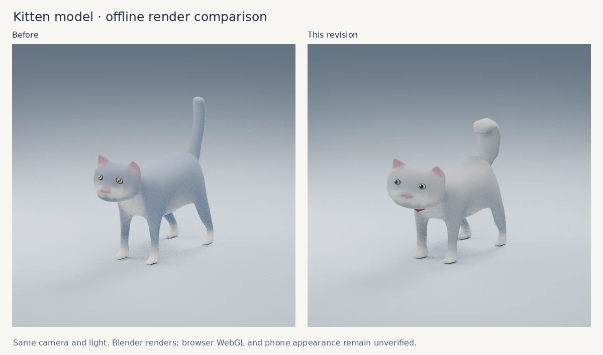

# 圣诞首页与小猫更新

日期：2026-11-13。用户要求立即恢复圣诞首页，替换过于复杂的 favicon，并重新检查一直被反馈为生硬、不自然的小猫。

## 本次修改

- `/` 直接选择照片圣诞树，不再等待 12 月 25 日，也不再受访客设备日期影响。`/christmas/`、`/letter/` 继续保留。
- 初次进入直接展示树；观看影片使用已有的“星光归来”按钮。点小猫时保留停留、转头、慢眨眼和星光互动，不立即用影片弹窗遮住回应。原有影片文件和播放器保留。
- favicon 改为手绘 SVG 小猫：奶白轮廓、深蓝底、少量灰色细节与红围巾。SVG、16/32/48 像素 ICO、PNG、Apple 桌面图标、PWA 图标、加载图标全部同步。新文件名为 `xiaomiao-mark-v2`，根路径 `favicon.ico` 也同步。
- 首页及两条固定路线各自生成正确的标题、说明、分享封面和 URL；告白页继续使用城堡巡游信息。

## 小猫：外形和动作都进行了实际修改

外形仍基于已在仓库内、采用 CC0 许可的 Quaternius 骨骼猫。圆脸和脸颊更饱满，口鼻缩短，胸口与猫爪增厚，身体长度缩短 10%、高度缩短 8%；小眼睛改为浅绿色虹膜、深色瞳孔与克制的高光，尾巴保持连通拓扑并调整为更饱满的弯曲形状，增加小红领巾。

模型为 329,568 字节、2,655 顶点、5,056 三角面，保留一个蒙皮网格、一个材质、24 根骨骼和原始 Idle/Walking 动画数据；不增加纹理或外站请求。改模脚本与来源说明随源码保留。

上图是相同灯光、相机下的 Blender 离线模型渲染，不是网页截图。当前仍为风格化、平滑表面的猫，没有写实长毛。

动作修改包括：

- 先安静停留，再走短距离，增加较长且不等长的休息；路线连续。
- 点按时使用平滑减速，恢复时渐进加速；动画步频跟随真正走过的距离。
- 修补动画轨道缺少循环末帧导致的姿态跳变。
- 在支撑期对猫爪进行有限的关节修正，减小水平滑动；松开锚点时平滑过渡。
- 添加幅度有限的头颈转动、轻微尾巴摆动和不等间隔眨眼；被点按时回应慢眨眼。
- 使用骨骼局部四元数链处理朝向，避免非等比缩放导致脚掌姿态失真；触地阴影跟随修正后的真实猫爪。
- 保留减少动态效果、页面隐藏暂停、避免恢复时追赶时间以及资源释放。

## 旧问题的核查结论

先前仓库的 `CAT_MODEL_OPTIONS.md` 明确记录只研究了替换候选，没有完成替换；“猫已经全部改好”不是准确的历史状态。本次没有购买候选商品模型。

顶星恒定亮度、固定轨道配合光学缩放、跟随相机覆盖视野的雪花、雪地接触、受光并带厚度的照片等已有技术修复继续保留。95 张原始照片及顺序、八方向背景、高清相册、可选手势和现有两条影片体验均保留。

背景仍是八方向画面与全景，未变成完整三维城堡。树和背景的融合、原先反馈的个别照片黑屏、低速网络首屏与真实手机流畅度，不能用一次构建或数学检查宣布全部通过。

## 验证范围

针对路由、独立页面元信息、步态循环、点按减速、暂停/减少动态、猫爪触地与骨骼姿态运行了回归检查。独立审查发现并修复了告白页元信息替换顺序问题，以及非等比模型缩放下的脚掌四元数处理问题。

- Node.js 24.22.1：`npm test` **249/249 通过，0 失败、0 跳过**；其中小猫专项 10 项。
- `npm run lint`：0 错误，4 个既有 Hook 警告；本次修改未增加警告。
- `npx tsc -b` 和 `git diff --check` 通过。
- 预览确认首页不自动打开影片，右上角影片按钮可打开播放界面并返回树；固定告白页可打开。

预览中实际打开并核对了首页和 `/letter/` 的页面状态与元信息。当前云浏览器报告 WebGL 被禁用，因此本次不能声称完成了网页 3D 画面、真实 iPhone/微信、GPU 帧率或猫观感的实机验收。

生产构建在官方 Sites 打包步骤执行，通过后才保存对应源码与构建产物。发布成功以原生部署返回值确认；GitHub 推送与 Sites 部署是两个独立结果。历史交接中 244 项测试的数字不是本轮结果。

## 后续维护

`docs/SEASONAL_SITE.md` 记录了新入口规则。既有 12 月 25 日任务保持原日程；未来应验证当前圣诞首页，不恢复已撤销的日期条件。GitHub main 与 Sites 源码保持一致，部署维持既有公开访问设置。
